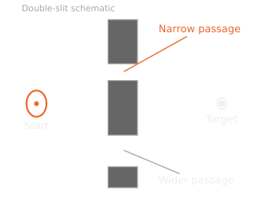
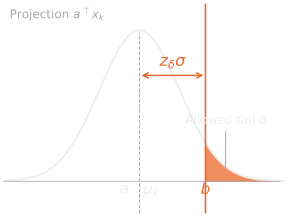
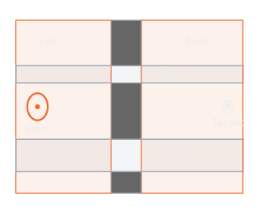
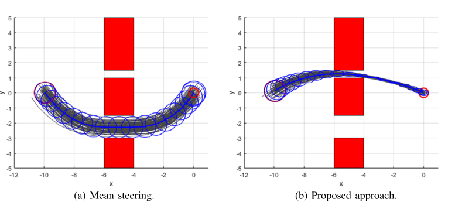

---
metadata-files:
  - ../../../_assets/revealjs-defaults.yml
title: "Stochastic Vehicle Path Planning Using [Covariance Steering]{.accent}"
subtitle: "MERO 5333 · Research Paper Implementation · Draft"
author: "Bennett Dogbey"
institute: "School of Mechanical and Aerospace Engineering Oklahoma State University"
date: "2026-11-06"
description: "A course-project draft on finite-horizon covariance steering, Gaussian chance constraints, and the double-slit experiment, with a planned process-noise investigation."
image: assets/double-slit.svg
event_type: "Course Project"
format:
  revealjs:
    theme: [default, ../../../_assets/theme.scss, deck.scss]
    logo: ../../../assets/logo.png
    center: false
    slide-number: c/t
    margin: 0.07
    html-math-method:
      method: mathjax
      url: https://cdn.jsdelivr.net/npm/mathjax@2.7.9/MathJax.js
title-slide-attributes:
  data-background-image: ../../../assets/background.jpg
  data-background-opacity: "0.3"
  data-background-color: "#252525"
---

## Path planning under [uncertainty]{.accent} {#introduction}

::: {.section-label}
Introduction
:::

:::: {.columns}
::: {.column width="46%"}

- Initial-state uncertainty and disturbances spread possible trajectories.
- A feasible mean path can still have a substantial collision risk.
- Covariance steering plans the **mean trajectory and its uncertainty together**.

**Running example:** a shorter, narrow passage and a wider alternative.

:::
::: {.column width="54%"}

{.diagram fig-alt="Schematic double-slit map with an uncertain start, a narrow upper passage, a wider lower passage, and a target"}

::: {.source}
Original schematic inspired by [1], Fig. 2. Geometry shown for explanation.
:::
:::
::::

::: {.notes}
The main paper is K. Okamoto and P. Tsiotras, Optimal Stochastic Vehicle Path Planning Using Covariance Steering, IEEE RA-L, 2019. DOI: https://doi.org/10.1109/LRA.2019.2901546. The central issue is that open-loop mean planning leaves the uncertainty uncontrolled. A narrow passage can be feasible for the mean but infeasible after accounting for the uncertainty margin. Explain the ellipse as a contour of the position marginal, not a hard support boundary. Gaussian distributions have unbounded support. This schematic has no optimized trajectory and is not a numerical result. The actual implementation must declare its geometry separately.
:::

## Project [objectives]{.accent} {#objectives}

::: {.section-label}
Objectives
:::

1. Implement the paper's finite-horizon covariance-steering formulation in Python.
2. Reproduce the double-slit comparison with mean steering.
3. Validate predicted moments, terminal constraints, and collision estimates.
4. Investigate how **process-noise intensity** changes passage feasibility and route selection.

::: {.result-status}
Presentation structure: Introduction, Objectives, Approach, Simulation and Results, Conclusion.
:::

::: {.notes}
Separate reproduction from independent investigation. Reproduction targets the qualitative route choice in [1], Fig. 2. Validation checks whether simulation implements the optimized policy and matches its predicted moments. The independent investigation changes only process-noise scale while keeping the remaining settings fixed. There are no completed optimization or Monte Carlo results in this draft. Earlier supporting papers are [2], chance-constrained covariance control, and [3], finite-horizon LTV covariance control. The 2019 controller parameterization remains the implementation target.
:::

## Stochastic [optimal control problem]{.accent} {#problem}

::: {.section-label}
Approach · 1
:::

:::: {.columns}
::: {.column width="48%"}

$$
x_{k+1}=A_kx_k+B_ku_k+D_kw_k
$$

$$
x_0\sim\mathcal N(\mu_0,\Sigma_0),\qquad
w_k\sim\mathcal N(0,I)
$$

::: {.small}
- Independent initial state and disturbances.
- Independent disturbances across time.
- Fully observed state and known model.
- Finite horizon $k=0,\ldots,N-1$.
:::

:::
::: {.column width="52%" .compact-math}

$$
\min_{\pi}\quad
\mathbb E\!\left[\sum_{k=0}^{N-1}
x_k^\top Q_kx_k+u_k^\top R_ku_k\right]
$$

$$
\begin{aligned}
\mathbb E[x_N]&=\mu_f,\\
\operatorname{Cov}(x_N)&=\Sigma_f,\\
\Pr(x_k\notin\chi)&\le\epsilon_k.
\end{aligned}
$$

::: {.small}
$\pi$: causal control policy. $Q_k\succeq0$, $R_k\succ0$.

The solution method relaxes terminal covariance equality to an **upper bound**.
:::

:::
::::

::: {.source}
[1], Sec. II, Eqs. (1)–(6). $\mu_f,\Sigma_f$ denote terminal targets.
:::

::: {.notes}
Explain that x_k includes position and velocity, u_k is acceleration, and D_kD_k^T is the process-noise covariance. At this stage pi denotes a general causal policy, so Gaussian state distributions have not yet been established for arbitrary pi. The affine policy on the next slide preserves joint Gaussianity. The paper originally states terminal covariance equality and then relaxes it to an upper bound for convex optimization. Our notation distinguishes actual terminal covariance Sigma_N from target Sigma_f. The paper uses a pointwise state-risk bound. It is not automatically a whole-horizon risk bound. Source: [1], Sec. II, Eqs. (1)-(6).
:::

## Control policy and [trajectory representation]{.accent} {#policy}

::: {.section-label}
Approach · 2
:::

:::: {.columns}
::: {.column width="48%"}

$$
\boxed{u_k=v_k+K_ky_k}
$$

$$
\begin{aligned}
y_{k+1}&=A_ky_k+D_kw_k,\\
y_0&=x_0-\mu_0.
\end{aligned}
$$

::: {.small}
$v_k$: mean input. $K_k$: feedback gain.

$y_k$ is an auxiliary uncertainty state with **fixed statistics**.
:::

:::
::: {.column width="52%"}

$$
X=\mathcal A x_0+\mathcal B U+\mathcal D W
$$

$$
U=V+KY,\qquad
Y=\mathcal A(x_0-\mu_0)+\mathcal DW
$$

::: {.small}
$X=[x_0^\top,\ldots,x_N^\top]^\top$.

$V=[v_0^\top,\ldots,v_{N-1}^\top]^\top$.

$K$ has blocks $K_k$ on its diagonal and a final zero block column.
:::

:::
::::

::: {.source}
[1], Eqs. (7), (12)–(14). In general, $y_k\ne x_k-\mathbb E[x_k]$.
:::

::: {.notes}
The paper's controller uses an auxiliary, uncontrolled uncertainty process y. Do not substitute the actual controlled state deviation into this policy. Since E[y_k]=0, E[u_k]=v_k. Stack all N+1 states and N controls. K has dimensions N n_u by (N+1)n_x, with K_0 through K_{N-1} on the block diagonal and a zero final block column. The dependence on realized uncertainty is causal. With full-state observation, after receiving x_{k+1}, reconstruct r_k=x_{k+1}-A_kx_k-B_ku_k=D_kw_k and update y_{k+1}=A_ky_k+r_k. No future disturbance is needed. Source: [1], Eqs. (7), (12)-(14). The full block-matrix example is in the backup slides.
:::

## Predicted [mean and covariance]{.accent} {#moments}

::: {.section-label}
Approach · 3
:::

$$
X=\underbrace{\mathcal A\mu_0+\mathcal BV}_{\text{mean}}
+\underbrace{(I+\mathcal BK)Y}_{\text{uncertainty}}
$$

:::: {.columns}
::: {.column width="49%"}

$$
\mu_X=\mathcal A\mu_0+\mathcal BV
$$

$$
\Sigma_Y=\mathcal A\Sigma_0\mathcal A^\top+
\mathcal D\mathcal D^\top
$$

::: {.small}
$V$ steers the mean. $\Sigma_Y$ is known before optimization.
:::

:::
::: {.column width="51%" .compact-math}

$$
\Sigma_X=(I+\mathcal BK)\Sigma_Y(I+\mathcal BK)^\top
$$

$$
\Sigma_Y=LL^\top,\quad
G(K)=(I+\mathcal BK)L
$$

$$
\boxed{\Sigma_X=GG^\top}
$$

::: {.small}
$K$ shapes covariance. Its factor $G(K)$ is **affine in $K$**.
:::

:::
::::

::: {.source}
[1], Eqs. (15)–(17). $L$ is a fixed covariance factor, not a decision variable.
:::

::: {.notes}
Substitute U=V+KY into the stacked dynamics and use x_0=mu_0+(x_0-mu_0). The initial random part and process noise combine to Y, yielding X=mu_X+(I+BK)Y. Initial-state and disturbance independence remove cross terms from Sigma_Y. A convenient factor is L=[A Sigma_0^{1/2}, D]. The mean depends only on V and covariance only on K, but obstacle constraints couple their choices. Define E_k as the matrix selecting x_k from X. Then mu_k=E_k mu_X and Sigma_k=E_k G G^T E_k^T. G is affine in K, enabling convex norm constraints later. Source: [1], Eqs. (15)-(17).
:::

## Cost and [terminal distribution]{.accent} {#cost-terminal}

::: {.section-label}
Approach · 4
:::

$$
\mathbb E[z^\top Qz]=\mu_z^\top Q\mu_z+\operatorname{tr}(Q\Sigma_z)
$$

:::: {.columns}
::: {.column width="56%" .compact-math}

$$
\begin{aligned}
J(V,K)={}&\|\bar Q^{1/2}\mu_X\|_2^2
+\|\bar R^{1/2}V\|_2^2\\
&+\|\bar Q^{1/2}G\|_F^2
+\|\bar R^{1/2}KL\|_F^2.
\end{aligned}
$$

::: {.small}
Mean-state cost and mean-input effort, plus the cost of state and input variability.

Every term is a squared norm of an affine expression.
:::

:::
::: {.column width="44%"}

$$
E_N\mu_X=\mu_f
$$

$$
E_NGG^\top E_N^\top\preceq\Sigma_f
$$

::: {.small}
$E_NX=x_N$ selects the terminal state.

The upper bound limits terminal variance **in every direction**.

An equivalent semidefinite constraint gives a convex formulation.
:::

:::
::::

::: {.source}
[1], Eqs. (17)–(19). $\bar Q=\mathrm{blkdiag}(Q_0,\ldots,Q_{N-1},0)$ and $\bar R=\mathrm{blkdiag}(R_0,\ldots,R_{N-1})$.
:::

::: {.notes}
Write z=mu+e. Expanding z^TQz produces a mean term, a zero-mean cross term, and E[e^TQe]=tr(Q Sigma). Apply the identity to X and U. Sigma_U=K Sigma_Y K^T=(KL)(KL)^T. Using tr(HH^T)=||H||_F^2 gives the four norm terms. Qbar has a final zero block because the paper imposes terminal conditions instead of terminal cost. E_N selects the terminal state. The covariance inequality does not mean entrywise comparison. For every a, a^T Sigma_N a <= a^T Sigma_f a. Its equivalent Schur-complement LMI appears in backup. Source: [1], Eqs. (17)-(19). This convexity claim applies to fixed region schedules and the selected controller class.
:::

## Gaussian [chance constraints]{.accent} {#chance-constraints}

::: {.section-label}
Approach · 5
:::

:::: {.columns}
::: {.column width="57%" .compact-math}

$$
\Pr(a^\top x_k\le b)\ge1-\delta
$$

$$
\boxed{a^\top\mu_k+z_\delta
\sqrt{a^\top\Sigma_ka}\le b}
$$

$$
z_\delta=\Phi^{-1}(1-\delta),\qquad 0<\delta<\tfrac12
$$

Using $\Sigma_k=E_kGG^\top E_k^\top$:

$$
a^\top E_k\mu_X+z_\delta
\|G^\top E_k^\top a\|_2\le b.
$$

:::
::: {.column width="43%"}

{.diagram fig-alt="Gaussian projection toward a boundary, showing the mean, uncertainty margin, and an allowed violation tail"}

::: {.small}
The safety margin grows with directional uncertainty and the required confidence.
:::

:::
::::

::: {.source}
[1], Eq. (20). With fixed $\delta$, the final expression is a second-order-cone constraint.
:::

::: {.notes}
Under the affine controller, a^T x_k is scalar Gaussian with mean m=a^Tmu_k and standard deviation s=sqrt(a^TSigma_k a). Standardizing gives Phi((b-m)/s)>=1-delta, or m+Phi^{-1}(1-delta)s<=b. The deterministic expression also applies for zero variance. The covariance factor gives s=||G^T E_k^T a||_2. Fixed delta below one half makes z_delta positive, so the affine term plus positive multiple of a norm is convex. The plotted tail is schematic, deliberately larger for visibility, and is not the 10^-3 experiment threshold. A smaller delta means a larger quantile and more required clearance. Source: [1], Eq. (20). The 2018 supporting paper [2] develops chance-constrained covariance control.
:::

## Obstacles and [region selection]{.accent} {#regions}

::: {.section-label}
Approach · 6
:::

:::: {.columns}
::: {.column width="52%"}

{.diagram fig-alt="Double-slit free space represented by overlapping left, right, upper-passage, and lower-passage rectangles"}

::: {.small}
Consecutive states share a selected convex region.
:::

:::
::: {.column width="48%" .compact-math}

$$
\chi=\bigcup_{r=1}^{N_R}\mathcal R_r,\qquad
\mathcal R_r=\bigcap_q\{x:a_{r,q}^\top x\le b_{r,q}\}
$$

$$
m_{r,k}\in\{0,1\},\qquad \sum_r m_{r,k}=1
$$

::: {.small}
$m_{r,k}=1$: impose region $r$'s face constraints at **both $k$ and $k+1$**.

For a region risk bound $\epsilon$, allocate face risks with $\sum_q\delta_{r,q}\le\epsilon$.
:::

:::
::::

::: {.source}
[1], Sec. III-B, Eqs. (22)–(25). Geometry and colors are explanatory schematics.
:::

::: {.notes}
The free space is a union of overlapping polytopes. A binary variable selects one region for each of the N intervals in our implementation indexing k=0,...,N-1. Selection implies that both endpoint distributions satisfy every face chance constraint. Overlap allows a route to transition between regions. One selected region does not mean the state cannot belong to another. For a desired region-level risk epsilon, the union bound requires sum of its face risks <= epsilon. The paper's Eq. (25) uses epsilon per face; its region-level interpretation must therefore account for the number of faces. We will state which convention the implementation uses. Convexity protects a straight segment when both realized endpoints lie in a region. It does not alone establish continuous-time safety for the actual stochastic double-integrator path. Source: [1], Eqs. (22)-(25), Fig. 3.
:::

## Final optimization and [solution procedure]{.accent} {#optimization}

::: {.section-label}
Approach · 7
:::

:::: {.columns}
::: {.column width="61%" .compact-math}

$$
\begin{aligned}
\min_{V,K,m}\quad &J(V,K)\\
\text{subject to}\quad
&E_N\mu_X=\mu_f,\\
&E_NGG^\top E_N^\top\preceq\Sigma_f,\\
&m_{r,k}=1\Rightarrow\text{region constraints},\\
&\sum_r m_{r,k}=1,\quad m_{r,k}\in\{0,1\},\\
&V_{\min}\le V\le V_{\max},\\
&K_{\min}\le K\le K_{\max}.
\end{aligned}
$$

:::
::: {.column width="39%" .small}

1. Build prediction matrices and $L$.
2. Formulate cost and constraints.
3. Solve for $V,K$ and the region schedule.
4. Simulate the policy and evaluate safety.

**Fixed region schedule:** convex conic problem.

**Region selection:** discrete search.

:::
::::

::: {.source}
[1], Algorithm 1. Initial implementation: prescribed schedules, followed by passage and switching-time search.
:::

::: {.notes}
This is the complete formulation, with mu_X=A mu_0+B V, G=(I+B K)L, fixed block structure of K, and fixed risk allocations understood. The terminal covariance constraint has an SDP representation, so the complete model should not be called a pure MISOCP. A direct mixed-integer SDP is not supported by the usual CVXPY/MOSEK combination. First validate continuous subproblems with fixed schedules, then compare passage and switching-time schedules. Restricted enumeration is a deviation from unrestricted binary selection and must be documented. The project rules require instructor approval if this constitutes the final substantial portion rather than the full algorithm. Bounds on V and K restrict parameters, not every stochastic realization of u. The result is optimal within the chosen controller and route-search class. Source: [1], Algorithm 1. Solver reference: https://www.cvxpy.org/tutorial/solvers/ .
:::

## Double-slit [simulation setup]{.accent} {#simulation-setup}

::: {.section-label}
Simulation and Results
:::

:::: {.columns}
::: {.column width="51%" .compact-table}

| Published setting | Value |
|:--|:--|
| State and input dimensions | $n_x=4$, $n_u=2$ |
| Time step | $\Delta t=0.2$ s |
| Horizon | $N=20$ intervals |
| Disturbance matrix | $D=10^{-2}I_4$ |
| Reported threshold | $\epsilon=10^{-3}$ |
| Parameter bounds | $|V_{ij}|\le100$, $|K_{ij}|\le10$ |

:::
::: {.column width="49%" .small}

**Parameters to specify explicitly**

- Initial and target distributions.
- State and control cost weights.
- Exact obstacle and region coordinates.
- Per-face risk allocation and solver tolerances.

These choices are not fully tabulated in the paper.

:::
::::

::: {.source}
[1], Sec. IV-B. Disturbance covariance is $DD^\top=10^{-4}I_4$.
:::

::: {.notes}
These reported parameters come from [1], Sec. IV-B. The paper uses YALMIP and MOSEK. We intend Python with a conic modeling package. The explicitly chosen position-velocity discretization is in backup. Do not label the first experiment an exact numerical replication until all missing settings have been recovered or reconstructed and documented. The paper gives parameter bounds on V and K, not hard bounds on random controls. The threshold is reported as epsilon=1e-3, while Eq. (25) applies it per face. A conservative region-risk allocation is a declared deviation if used. No optimization has yet been run for this draft.
:::

## Published [double-slit result]{.accent} {#published-result}

::: {.section-label}
Simulation and Results · Reference result
:::

{.paper-figure fig-alt="Figure 2 from Okamoto and Tsiotras 2019: mean steering takes the wider lower slit and covariance steering takes the narrow upper slit" width="88%"}

:::: {.columns}
::: {.column width="50%" .small}
**Mean steering:** uncontrolled covariance leads to the wider passage.
:::
::: {.column width="50%" .small}
**Covariance steering:** covariance contraction enables the narrow passage.
:::
::::

::: {.source}
Reproduced from [1], Fig. 2, p. 2280. Published evidence, not results from our implementation.
:::

::: {.notes}
This image is the published figure extracted from the supplied paper, not generated or reproduced by our code. Source: K. Okamoto and P. Tsiotras, IEEE RA-L 4(3):2276-2281, 2019, Fig. 2, p. 2280, https://doi.org/10.1109/LRA.2019.2901546. In the mean-steering baseline K=0. The paper omits the terminal covariance constraint for this baseline because covariance is uncontrolled. Its proposed controller contracts the uncertainty and uses the upper slit. This is the qualitative behavior our implementation aims to reproduce. It is not a universal claim that covariance steering always prefers the narrower route. The narrower-top-slit variant in Fig. 4 favors the lower route because the uncertainty-reduction cost is too high.
:::

## Reproduction and [validation]{.accent} {#validation}

::: {.section-label}
Simulation and Results · Implementation results pending
:::

::: {.compact-table}
| Component | Mean steering | Covariance steering |
|:--|:--|:--|
| Optimized variables | $V$, with $K=0$ | $V,K$ |
| Terminal mean | Enforced | Enforced |
| Terminal covariance bound | Omitted, following [1] | Enforced |
| Passage, cost, collision rate | Pending | Pending |
:::

:::: {.columns}
::: {.column width="52%" .small}

**Moment validation**

Compare analytical $\mu_k,\Sigma_k$ with sample estimates from policy rollouts.

:::
::: {.column width="48%" .small}

**Constraint validation**

Check terminal residuals, face margins, and pointwise versus trajectory collision estimates.

:::
::::

::: {.result-status}
Numerical trajectories, covariance ellipses, and quantitative comparisons will follow implementation.
:::

::: {.notes}
All implementation-result cells are pending. Compare the same geometry, dynamics, objective, and risk convention. Match [1]'s baseline by omitting its terminal covariance bound, while retaining the terminal mean. For Monte Carlo use the exact auxiliary-state policy. Report norm(mu_hat_k-mu_k), relative covariance error when meaningful, terminal mean residual, and lambda_max(Sigma_N-Sigma_f). For numerical feasibility, the last quantity must be <= tolerance. Check each active face's deterministic margin. Report pointwise obstacle hits and the fraction of rollouts with at least one collision separately. Attach binomial confidence intervals. Start with 5,000 rollouts for debugging; use larger counts, around 100,000 at selected conditions, to assess rare events near 1e-3. The empirical collision probability can be below a conservative face/region bound and need not equal it.
:::

## Independent [noise investigation]{.accent} {#noise-investigation}

::: {.section-label}
Simulation and Results · Independent investigation
:::

**When does increasing process noise make the narrow passage too costly or infeasible?**

$$
D(\gamma)=\gamma D_{\mathrm{base}},\qquad
\gamma\in\{0.5,1,1.5,2,3\}
$$

:::: {.columns}
::: {.column width="50%" .small}

**Hold fixed**

Geometry, initial distribution, horizon, weights, risk thresholds, and controller bounds.

**Measure**

Passage feasibility, selected route, expected cost, control effort, entry covariance, and collision frequency.

:::
::: {.column width="50%" .small}

**Hypothesis**

Higher noise increases the required feedback effort and can eliminate the narrow-passage advantage.

**Analysis**

Bracket any route transition and identify the constraints responsible. An absent transition is also a result to explain.

:::
::::

::: {.source}
Proposed experiment. Process-noise covariance scales as $D(\gamma)D(\gamma)^\top=\gamma^2D_{\mathrm{base}}D_{\mathrm{base}}^\top$.
:::

::: {.notes}
This is our independent technical investigation, not a published or completed result. Do not vary initial covariance or other settings simultaneously. Solve upper and lower schedules for both methods at each gamma using the same search space. Record infeasibility rather than silently dropping a condition. If route preference changes between two tested noise levels, refine that interval and inspect active safety, terminal, gain, and feedforward constraints. Distinguish route cost crossover from loss of feasibility. Stronger noise increases covariance for a fixed controller and therefore its uncertainty-related cost and safety margins, but the optimized route response is an experimental outcome. Use paired random seeds for Monte Carlo method comparisons when practical. Separate observed safety performance from the model's analytic bounds.
:::

## [Conclusion]{.accent} {#conclusion}

::: {.section-label}
Conclusion
:::

- The controller parameterization separates **mean steering** from **covariance shaping**.
- Gaussian chance constraints connect uncertainty directly to obstacle clearance.
- Region decomposition turns route selection into a discrete search over convex subproblems.

::: {.result-status}
Experimental conclusions remain pending. The final assessment will use reproduction accuracy, empirical validation, and the process-noise investigation.
:::

::: {.notes}
These are mathematical conclusions supported by the formulation, not numerical findings. The finite-horizon controller makes uncertainty a planning variable. Safety remains probabilistic and depends on model assumptions, risk allocation, and time discretization. The final presentation should replace the pending paragraph with evidence-based implementation findings, including any route switch, feasibility limitation, or discrepancy from the paper. Do not claim successful reproduction or improved collision rate before obtaining results. Potential limitations include full-state observation, Gaussian linear modeling, conservative region decomposition, terminal-covariance relaxation, and a restricted route search if enumeration is retained.
:::

## [References]{.accent} {#references}

::: {.references}

[1] K. Okamoto and P. Tsiotras, “Optimal stochastic vehicle path planning using covariance steering,” *IEEE Robotics and Automation Letters*, vol. 4, no. 3, pp. 2276–2281, 2019. [doi:10.1109/LRA.2019.2901546](https://doi.org/10.1109/LRA.2019.2901546).

[2] K. Okamoto, M. Goldshtein, and P. Tsiotras, “Optimal covariance control for stochastic systems under chance constraints,” *IEEE Control Systems Letters*, vol. 2, no. 2, pp. 266–271, 2018.

[3] M. Goldshtein and P. Tsiotras, “Finite-horizon covariance control of linear time-varying systems,” in *2017 IEEE 56th Annual Conference on Decision and Control*, pp. 3606–3611, 2017.

:::

::: {.notes}
Reference [1] is the main implementation target and the source of the controller and double-slit experiment. References [2] and [3] provide supporting covariance-control formulations. Their controller parameterizations must be checked before combining equations. Full BibTeX entries are provided alongside the deck in references.bib.
:::

## Double-integrator [model]{.accent} {#backup-model}

::: {.section-label}
Backup · System model
:::

$$
x_k=[p_{x,k},p_{y,k},v_{x,k},v_{y,k}]^\top,
\qquad u_k=[a_{x,k},a_{y,k}]^\top
$$

$$
A=\begin{bmatrix}I_2&\Delta t I_2\\0&I_2\end{bmatrix},
\qquad
B=\begin{bmatrix}\tfrac12\Delta t^2 I_2\\\Delta t I_2\end{bmatrix}
$$

$$
x_{k+1}=Ax_k+Bu_k+Dw_k,\qquad Q_w=DD^\top
$$

::: {.small}
Chosen discretization: constant acceleration over each interval, with additive discrete-time noise.

For $N=20$: $X\in\mathbb R^{84}$, $U\in\mathbb R^{40}$, and $K\in\mathbb R^{40\times84}$.
:::

::: {.notes}
This is our explicit discretization choice for the double integrator. With dt=0.2, the input blocks are 0.02 I_2 for position and 0.2 I_2 for velocity. Noise is added as the paper's stated D=0.01 I_4, rather than derived by discretizing a continuous-time acceleration-noise process. Those are different models and should not be silently interchanged. There are 21 states and 20 controls. K has 20 independent 2-by-4 blocks, giving 160 free feedback parameters, not 40 times 84 independent parameters.
:::

## Stacked [dynamics]{.accent} {#backup-stacked}

::: {.section-label}
Backup · Two-interval example
:::

$$
\begin{bmatrix}x_0\\x_1\\x_2\end{bmatrix}
=\underbrace{\begin{bmatrix}I\\A\\A^2\end{bmatrix}}_{\mathcal A}x_0
+\underbrace{\begin{bmatrix}0&0\\B&0\\AB&B\end{bmatrix}}_{\mathcal B}
\begin{bmatrix}u_0\\u_1\end{bmatrix}
+\underbrace{\begin{bmatrix}0&0\\D&0\\AD&D\end{bmatrix}}_{\mathcal D}
\begin{bmatrix}w_0\\w_1\end{bmatrix}.
$$

$$
K=\begin{bmatrix}K_0&0&0\\0&K_1&0\end{bmatrix},
\qquad U=V+KY.
$$

::: {.small}
Block-lower-triangular prediction matrices preserve causality. $E_kX=x_k$ extracts one time step.
:::

::: {.notes}
Expand x_1=Ax_0+Bu_0+Dw_0. Substitute it into x_2=Ax_1+Bu_1+Dw_1 to obtain A^2x_0+ABu_0+Bu_1+ADw_0+Dw_1. This gives the displayed matrix blocks. For time-varying dynamics replace A powers with ordered state-transition products. Verify the implementation by comparing recursive simulation with the stacked equation using identical x_0,U,W. Source: [1], Eq. (7), with its block matrices made explicit here.
:::

## Mean and covariance [derivation]{.accent} {#backup-moments}

::: {.section-label}
Backup · Distribution prediction
:::

$$
\begin{aligned}
X&=\mathcal A\mu_0+\mathcal BV+
\mathcal A(x_0-\mu_0)+\mathcal DW+\mathcal BKY\\
&=\mathcal A\mu_0+\mathcal BV+(I+\mathcal BK)Y.
\end{aligned}
$$

$$
\mathbb E[Y]=0,\qquad
\operatorname{Cov}(Y)=\mathcal A\Sigma_0\mathcal A^\top+\mathcal D\mathcal D^\top.
$$

$$
\mu_k=E_k(\mathcal A\mu_0+\mathcal BV),\qquad
\Sigma_k=E_kGG^\top E_k^\top.
$$

::: {.small}
Initial-state and disturbance independence remove the cross-covariance terms.
:::

::: {.notes}
Under the linear affine policy, the stacked state and control are affine functions of the jointly Gaussian initial state and disturbances. They are therefore jointly Gaussian. This is what justifies the scalar Gaussian projection used in chance constraints. The affine factor G captures temporal correlations too: off-diagonal blocks of Sigma_X represent cross-time covariance. The pointwise face constraints use only the diagonal time blocks. Source: [1], Eqs. (15)-(17).
:::

## Expected quadratic [cost]{.accent} {#backup-cost}

::: {.section-label}
Backup · Trace identity
:::

$$
\begin{aligned}
z&=\mu+e,\qquad \mathbb E[e]=0,\\
\mathbb E[z^\top Qz]
&=\mu^\top Q\mu+2\mu^\top Q\mathbb E[e]+\mathbb E[e^\top Qe]\\
&=\mu^\top Q\mu+\operatorname{tr}(Q\Sigma).
\end{aligned}
$$

$$
\begin{aligned}
\Sigma_U&=(KL)(KL)^\top,\\
\operatorname{tr}(\bar QGG^\top)&=\|\bar Q^{1/2}G\|_F^2,\\
\operatorname{tr}(\bar R\Sigma_U)&=\|\bar R^{1/2}KL\|_F^2.
\end{aligned}
$$

::: {.notes}
Use the cyclic trace identity tr(ABC)=tr(BCA) and tr(HH^T)=||H||_F^2. Q and R are positive semidefinite and positive definite respectively, so square-root factors exist. Expected input effort includes both v^TRv and a variance cost from feedback. Reducing covariance is not free. The objective is quadratic and convex in the selected decision variables because each factor is affine. Source: [1], Eq. (17), with the trace steps expanded here.
:::

## Terminal covariance [constraint]{.accent} {#backup-terminal}

::: {.section-label}
Backup · Convex semidefinite form
:::

Let $H=E_NG(K)$. The relaxed terminal constraint is

$$
HH^\top\preceq\Sigma_f.
$$

By the Schur complement,

$$
\boxed{
\begin{bmatrix}
\Sigma_f&H\\
H^\top&I
\end{bmatrix}\succeq0.
}
$$

::: {.small}
For $\Sigma_f\succ0$, equivalently $\|\Sigma_f^{-1/2}H\|_2\le1$, where $\|\cdot\|_2$ is the **matrix spectral norm**.
:::

::: {.notes}
The identity lower-right block is positive definite. Its Schur complement is Sigma_f-HH^T, establishing equivalence. H is affine in K, so the block matrix is affine in the decision variables and the PSD constraint is convex. The norm in the equivalent representation is the matrix spectral norm, not a vector or Frobenius norm. Replacing it by a Frobenius norm constraint would be conservative and would change the feasible set. Combining this SDP constraint with binary region decisions creates a mixed-integer semidefinite formulation. Fixing the region schedule removes the integer variables. Source: [1], Eq. (19), with an equivalent LMI representation.
:::

## Safety [probability and risk allocation]{.accent} {#backup-risk}

::: {.section-label}
Backup · Scope of the guarantee
:::

$$
\Pr(x_k\notin\mathcal R_r)
\le\sum_q\Pr(a_{r,q}^\top x_k>b_{r,q})
\le\sum_q\delta_{r,q}.
$$

$$
\Pr\!\left(\bigcup_{k=0}^{N}\{x_k\notin\chi\}\right)
\le\sum_{k=0}^{N}\epsilon_k.
$$

::: {.small}
No independence assumption is needed for these union bounds.

A narrow passage of width $w$ with equal upper and lower face risks requires
:::

$$
2\Phi^{-1}(1-\delta)\,\sigma_{y,k}\le w.
$$

::: {.notes}
For a fixed selected region, leaving the free space implies leaving that region, so its risk bound controls the free-space violation probability. A horizon guarantee requires a budget over all distinct relevant time steps; sum duplicate constraints carefully rather than treating them as independent events. If all four faces receive epsilon=1e-3, the region-level union bound is at most 4e-3, not automatically 1e-3. Using epsilon/4 per face gives a region-level bound of epsilon. The displayed passage-width condition follows by adding mu_y-z_delta sigma_y>=y_min and mu_y+z_delta sigma_y<=y_max. It is necessary and sufficient for some vertical mean to satisfy those two face constraints at a fixed variance, but says nothing by itself about dynamics or the other faces. Source: [1], Eqs. (20), (25), interpreted with the union bound.
:::

## Controller [execution and scope]{.accent} {#backup-execution}

::: {.section-label}
Backup · Simulation and implementation choices
:::

$$
\begin{aligned}
y_0&=x_0-\mu_0,\\
u_k&=v_k+K_ky_k,\\
x_{k+1}&=A_kx_k+B_ku_k+D_kw_k,\\
y_{k+1}&=A_ky_k+D_kw_k.
\end{aligned}
$$

::: {.small}
- Use the same realized disturbance in the state and auxiliary recursions.
- Do not replace $y_k$ with $x_k-\mu_k$ or saturate inputs without updating the model.
- Declare reconstructed parameters and any restricted schedule search.
- Validate moment predictions before evaluating obstacle performance.
:::

::: {.notes}
For physical execution, replace D_kw_k in the y update by the observed residual x_{k+1}-A_kx_k-B_ku_k under the exact, fully observed model. Saturating a Gaussian affine control changes the state distribution and invalidates the derived Gaussian moment formulas. Input limits, if needed, require a different declared constraint or model. The initial plan is staged validation: stacked-matrix checks, obstacle-free covariance steering, fixed upper/lower schedules, then route and switching-time search. This slide documents intended execution, not completed code. The full implementation and its validation remain the next project stage.
:::
